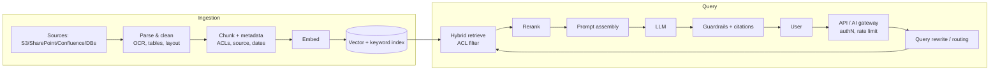

# Retrieval-Augmented Generation (RAG) Architecture
Last reviewed: 2026-10

## Reference architecture

## Ingestion design
- Parsing: PDFs with layout/tables (Textract, Azure Document Intelligence, Document AI, Unstructured,
  Docling, LlamaParse), HTML cleanup, OCR for scans.
- **Chunking**: fixed-size with overlap (e.g., 300–800 tokens, 10–20% overlap) baseline; structure-aware
  (headings/sections), semantic chunking, hierarchical/parent-child (retrieve small, return parent),
  late chunking/contextual chunk headers (prepend doc title/section summary to each chunk — "contextual
  retrieval"). Tune with evals, not intuition.
- Metadata: source URI, title, section, timestamps, tenant, **ACL principals**, doc type, language.
- Incremental sync: change detection (hashes/ETags), deletes propagate, re-embed on model change.

## Retrieval
- **Hybrid search** (BM25 keyword + dense vectors) fused via RRF or score normalization beats either alone
  for enterprise data (codes, names, acronyms).
- **Reranking** with cross-encoders (Cohere Rerank, Bedrock/Vertex rerankers, bge-reranker) on top 20–100
  candidates → top 3–10 to LLM.
- Query transformation: rewrite with conversation history, multi-query, HyDE, decomposition for multi-hop.
- Metadata filters (tenant, ACLs, date) applied **in the retrieval query** (pre-filtering).
- Routing: choose index/tool by intent (agentic RAG); text-to-SQL for structured data; GraphRAG for
  entity/relationship-heavy corpora and global summarization questions.

## Generation
Prompt with instructions + retrieved chunks (with IDs) + question; require citations; instruct to say
"I don't know" when context is insufficient; structured output; stream responses.

## Managed options
Bedrock Knowledge Bases (managed ingestion, vector stores: OpenSearch Serverless, Aurora pgvector, S3
Vectors, Pinecone, etc.; GraphRAG with Neptune ⚠️), Azure AI Search (integrated vectorization, semantic
ranker, agentic retrieval ⚠️) + Microsoft Foundry (Foundry IQ/agents ⚠️), Vertex AI Search / RAG Engine (now under Gemini Enterprise Agent Platform). Frameworks: LlamaIndex,
LangChain/LangGraph, Haystack, Semantic Kernel, Spring AI.

## Evaluation (do this first)
Build 50–200 Q/A pairs with ground-truth sources. Measure retrieval (recall@k, MRR, nDCG) separately from
generation (faithfulness/groundedness, answer correctness, citation accuracy). Tools: RAGAS, DeepEval,
TruLens, promptfoo, Bedrock/Azure/Vertex evaluation services.

## Performance & cost
Cache embeddings; semantic cache for repeated questions (with ACL awareness); limit context to what's
needed; smaller models for query rewrite; prompt caching for static system prompt; batch ingestion
embeddings; vector quantization for index cost.

## Security
Document-level ACL enforcement at retrieval with the end-user identity; tenant isolation; injection
defense on retrieved content; PII handling in ingestion; audit logs; see `security/ai-security.md`.

## Common failure modes & fixes
| Symptom | Likely cause | Fix |
|---|---|---|
| Right doc exists, not retrieved | Chunking/embedding mismatch, acronyms | Hybrid search, contextual chunks, query rewrite |
| Retrieved but wrong answer | Too much noise, lost-in-the-middle | Rerank, fewer/better chunks, ordering |
| Hallucinated citations | Weak grounding instructions | Citation IDs, groundedness checks |
| Stale answers | Sync lag | Incremental ingestion, freshness metadata & filters |
| Slow | Large context, sequential steps | Parallel retrieval, smaller models for subtasks, streaming |

## Enterprise architect lens — RAG as a shared platform
- **Shared ingestion service** with connectors (SharePoint, Confluence, S3, ServiceNow, Git), document-level ACL
  sync, PII classification, and per-source freshness SLAs; domains register sources, platform runs pipelines.
- **Retrieval API** (not direct index access): enforces user identity → ACL filters, tenant isolation, query
  logging, quotas; returns citations with source URIs; versioned.
- **Index strategy**: hot vectors in OpenSearch/AI Search; cold/billion-scale in S3 Vectors; per-domain or
  per-tenant indexes when ACL models diverge.
- **Quality ops**: golden Q/A sets per domain, retrieval + groundedness metrics in CI, online feedback loop,
  drift alerts when sources change; owners accountable for knowledge quality.
- **Build vs buy**: managed (Bedrock KB, Foundry IQ/AI Search, Vertex AI Search) for speed; custom pipelines for
  complex ACLs, multilingual (Indic) parsing, or cost control at scale.
