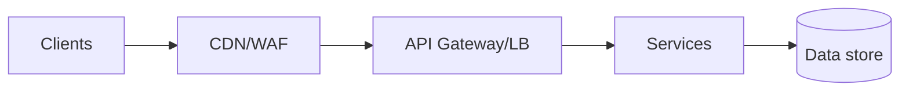

# <System Name> — Design Document

| Field | Value |
|---|---|
| Author(s) | |
| Status | Draft / In review / Approved |
| Last updated | YYYY-MM-DD |
| Reviewers | |

## 1. TL;DR
<3–5 lines: what, why, the key decision>

## 2. Context & problem
## 3. Goals / Non-goals
## 4. Requirements
### Functional
### Non-functional
| NFR | Target |
|---|---|
| Peak throughput | |
| Latency (p50/p99) | |
| Availability | |
| RPO / RTO | |
| Data residency / compliance | |
| Budget | |

## 5. Estimates
## 6. API design
## 7. Data model & access patterns
## 8. High-level architecture

## 9. Detailed design / deep dives
## 10. Security (threat model summary)
## 11. Reliability & DR
## 12. Observability (SLIs/SLOs, alerts)
## 13. Cost estimate
| Component | Sizing | $/month |
|---|---|---|
## 14. Alternatives considered
| Option | Pros | Cons | Why rejected |
|---|---|---|---|
## 15. Rollout / migration plan
## 16. Risks & open questions
## 17. Appendix (ADRs, references)
