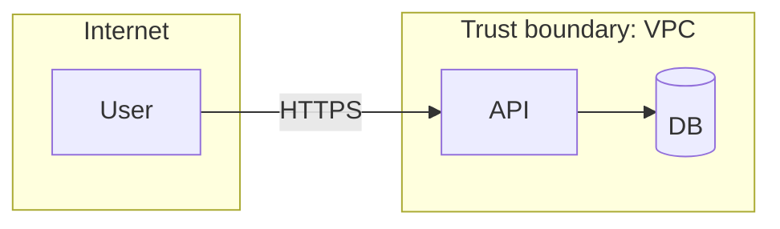

# Threat Model: <System>

## Scope & assets
| Asset | Classification (Public/Internal/Confidential/Restricted) | Owner |
|---|---|---|

## Data-flow diagram

## Threats (STRIDE / OWASP LLM for AI components)
| ID | Element | Category | Threat | Likelihood | Impact | Risk | Mitigation | Status |
|---|---|---|---|---|---|---|---|---|

## Security requirements derived (ASVS references)
## Residual risks & acceptance
| Risk | Accepted by | Date | Review date |
|---|---|---|---|
